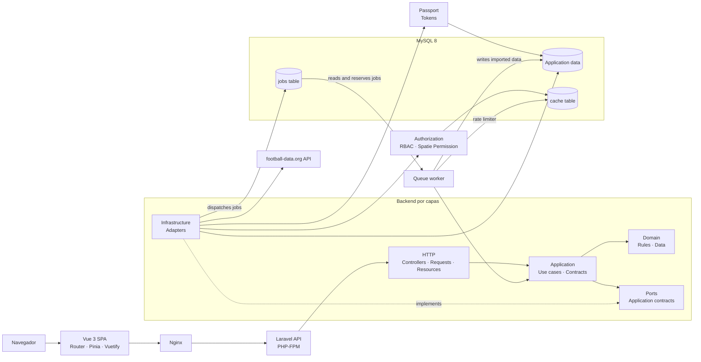

# Arquitectura

## Lectura del diagrama

- El frontend consume la API Laravel mediante HTTP.
- Los controladores solo coordinan la entrada HTTP y delegan en casos de uso.
- `Application` y `Domain` mantienen la lógica aislada de Eloquent y del proveedor externo.
- La infraestructura conecta la aplicación con MySQL, Passport, Spatie, cache, colas y football-data.org.
- La sincronización e importación se ejecutan de forma asíncrona mediante jobs en la cola `database`.
- El rate limit global de football-data.org usa el cache store `database`; la tabla `cache` coordina el límite entre jobs.
- Los `GET` consultan la copia local; solo los jobs de sincronización e importación llaman al proveedor externo.
