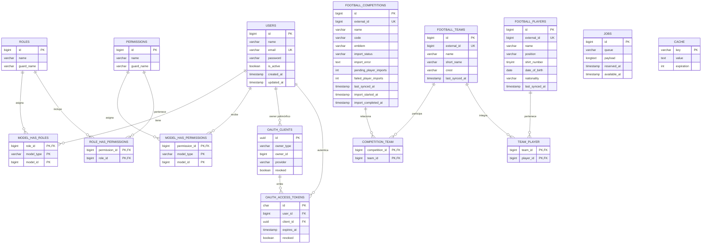

# Modelo de datos

## Interpretación

- Una liga puede tener muchos equipos y un equipo puede aparecer en varias ligas; la relación se almacena en "competition_team".
- Un equipo puede tener muchos jugadores y un jugador puede estar asociado a varios equipos; la relación se almacena en "team_player".
- Las tablas pivote tienen una clave primaria compuesta para impedir relaciones duplicadas.
- "external_id" identifica el registro en football-data.org y es único en ligas, equipos y jugadores. Esto permite repetir una importación sin duplicar datos.
- El número de camiseta pertenece actualmente al jugador porque es el dato recibido y persistido por la integración; la relación entre jugador y equipo no tiene atributos adicionales.
- Los campos de importación viven en "football_competitions" porque representan el estado agregado de la importación de una liga.

## Autorización y soporte técnico

Las tablas de roles y permisos corresponden a Spatie Permission. Las tablas "model_has_roles" y "model_has_permissions" son polimórficas; en este proyecto el modelo principal es User.

Las tablas de Passport ("oauth_clients" y "oauth_access_tokens") soportan la autenticación Bearer. Las tablas "jobs" y "cache" son infraestructura de Laravel: "jobs" permite la importación asíncrona y "cache" coordina el rate limiting y el cache de permisos.
