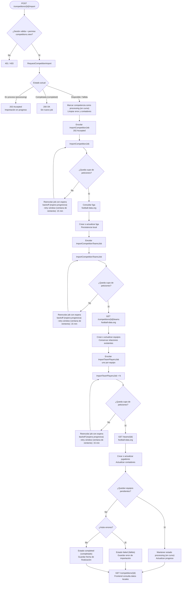

# Flujo de importación de una liga

## Decisiones representadas

- Cada job usa el middleware RateLimited('football-data'); si se alcanza el límite global de 10 peticiones (requests) por minuto, vuelve a la cola (queue) con backoff (espera progresiva).
- Los jobs tienen una retry window (ventana de reintento) de 15 minutos para recuperarse de límites o errores temporales del proveedor.
- Las operaciones de persistencia son idempotentes: los reintentos actualizan registros existentes en lugar de duplicarlos.
- Los errores no reintentables se registran en la competencia y actualizan sus contadores; el frontend puede mostrar progreso y errores parciales.
- Los endpoints GET consultan la copia local y no llaman directamente a football-data.org.
